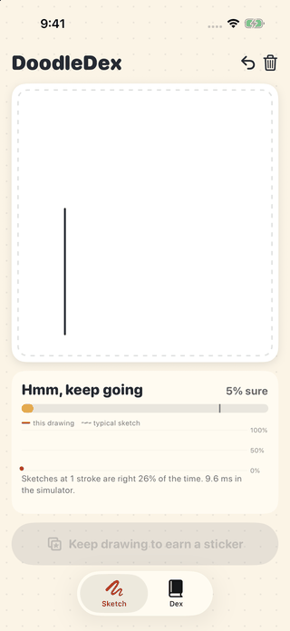
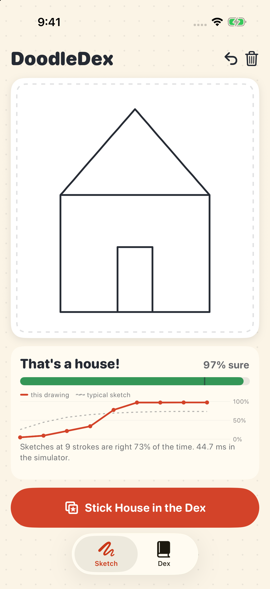
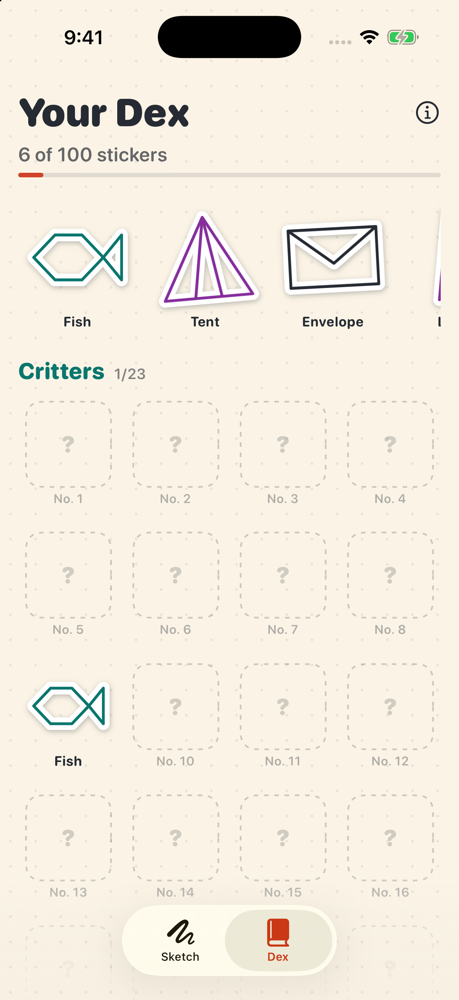
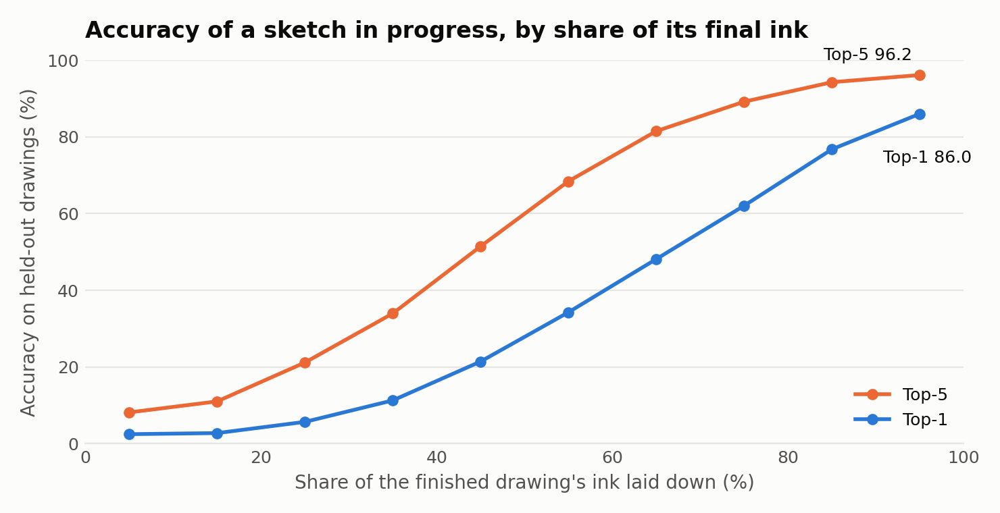
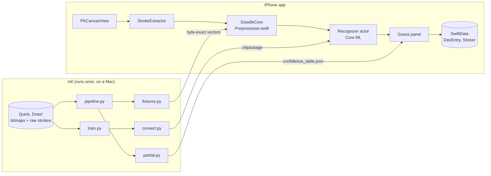

# DoodleDex

[](https://github.com/matejpopovski/DoodleDex/actions/workflows/ci.yml)

Draw on an iPhone and a 1.2 MB network trained on Google's Quick, Draw! guesses your sketch after every stroke, on the device. When it is sure, the drawing becomes a die-cut sticker in a 100-slot sticker book that persists with SwiftData.

<p>
  
  
  
</p>

Every frame above is a `simctl io` screenshot of the running app. The strokes are real touches synthesized by XCUITest, not injected data.

| | |
|---|---|
| Held-out test accuracy, 100 classes, 250,000 drawings | **88.68% top-1, 96.71% top-5** |
| Same drawings, Google's bitmaps vs this project's rendering of the raw strokes | 88.38% vs 88.24% top-1 |
| Swift pipeline vs Python pipeline on 194 fixtures | **0 bytes differ** |
| Model size | 1.16 MB, 299,780 parameters |
| **Simulator** latency, Release build on an Apple M3 Max | 0.25 ms pipeline, 0.99 ms inference (p50) |

## The bug this repo exists to prevent

A sketch recognizer on a phone can show 88% on the training machine and much less in your hand, with nothing to tell you. Quick, Draw! ships its training images as 28x28 bitmaps. The app has PencilKit strokes. If the code in the middle draws a slightly thicker line, centres the drawing differently, or antialiases in a way the network never saw, the app still produces confident answers. They are just worse, and no crash report will mention it.

So the most important code here is the path from a stroke to 784 bytes, and it had to be established rather than guessed, because Google documents only part of it. Their [dataset notes](https://github.com/googlecreativelab/quickdraw-dataset) describe the simplification: align to the origin, scale to 255, resample at 1 pixel, Ramer-Douglas-Peucker at epsilon 2. How those strokes became 28x28 images is not stated.

The dataset allows a stronger check than usual: record *i* of each `.npy` bitmap file is line *i* of the `raw` stroke file. `verify_dataset.py` feeds raw human strokes through the pipeline and compares the result with the bitmap Google published for the same drawing.

- A grid over line width and padding has a sharp minimum at 16 and 16 in 256-space. Moving the line width by 2 costs about six times the error (4.37 against 0.70, on a 0-255 scale per pixel).
- With a one-record misalignment the same comparison gives 54.9, so a match this close is not an accident.
- The first version of RDP measured distance to the *segment*, on the reasoning that it handles closed loops better. Against the published pixels that was wrong: mean error 1.23 and a worst case of 15.7, against 0.70 and 6.2 for the textbook distance to the infinite line. The shipped pipeline uses the textbook form, and `results/dataset_parity.json` keeps the comparison.
- 8x supersampling (error 0.70) was kept over 16x (0.37), because the work quadruples and the classifier already barely notices at 8x: against Google's bitmaps, the top guess changes on 1.0% of drawings and top-1 moves by 0.14 points.

That settles Python against Google. The Swift port is then held to Python by [fixtures](ml/doodledex_ml/fixtures.py): real raw strokes, partial sketches cut from them, the same strokes moved into phone-like coordinates, and hand-built edge cases such as a lone tap and a retraced line. Coordinates are stored as base64 float64, so the test does not depend on how a JSON parser rounds decimals. Both implementations are written as the same IEEE operations in the same order, which is why the comparison can be exact instead of tolerant.

### Link by link

| Link | Check | Result |
|---|---|---|
| Raw strokes to Google's bitmaps | `verify_dataset`, `partial` on 50,000 held-out drawings | 0.69 mean pixel error; 1.0% of top guesses change |
| Python pipeline to Swift pipeline | byte comparison, 194 fixtures, macOS and iOS 17.5, 18.0, 26.5 simulators | identical |
| PyTorch to Core ML | 4,000 test images | 100% top-1 agreement, largest probability difference 4.4e-6 |
| coremltools on macOS to Core ML in the simulator | every fixture, strokes through to guess | same top-1, probabilities within 0.001 |
| PKDrawing to strokes | 100 human drawings through real `PKStroke` objects | median 1.2 pixel error, 97/100 keep their guess |
| Confidence table, Python to Swift | 194 lookups | equal |

The last-but-one row is the only lossy link, and on purpose: PencilKit treats points as spline control points, so the app samples the curve the player actually sees. Dataset strokes are sparser than a phone's touch stream, and pushed in raw they lost 6 of 100 guesses. Densified to phone-like spacing it is 3 of 100.

A test that cannot fail proves nothing, so `scripts/parity_mutations.py` makes plausible porting mistakes in a copy of the package and counts the fixtures that notice:

| Mutation | Fixtures failed (of 194) |
|---|---|
| Line width 16 becomes 15 | 194 |
| 4x supersampling instead of 8x | 194 |
| Drawing not centred | 194 |
| Scale to 256 instead of 255 | 192 |
| No rounding to integers | 190 |
| RDP epsilon 2.0 becomes 2.5 | 170 |
| Strokes union instead of composite | 148 |

## What confidence means on an unfinished sketch

The app predicts after each stroke, but the network was trained on finished drawings, so its softmax score is meaningless early on. Measured by replaying held-out strokes through the whole pipeline, including re-framing each prefix to fill the canvas as the app does:

| Strokes drawn | Mean raw softmax score | Actually correct (top-1) | Top-5 |
|---|---|---|---|
| 1 | 51.7% | 25.6% | 44.3% |
| 2 | 57.8% | 44.7% | 66.9% |
| 3 | 62.8% | 58.0% | 79.2% |
| 4 | 65.2% | 65.1% | 84.8% |
| 6 | 68.6% | 71.6% | 89.5% |
| 8 | 69.0% | 73.6% | 91.1% |



After one stroke the score claims double the true accuracy. So the app never displays it. It displays a lookup of P(correct | strokes so far, raw score bin), fitted with pool-adjacent-violators on a separate split of 50,000 drawings, which takes the expected calibration error on the stroke test split from **6.4% to 0.27%**. A single temperature could not do this, because the correction depends on the stroke count. The table is 80 numbers that Swift reads in three lines, and the dashed line on the in-app chart is the measured accuracy at that stroke count.

The sticker offer uses the same probability. Since each drawing gets several looks at the bar, the threshold is chosen on what an offer delivers rather than on the per-prefix number:

| Bar | Drawings that earn an offer | Offers that are right | Ink used at the offer |
|---|---|---|---|
| 0.50 | 87.8% | 75.7% | 77% |
| 0.70 | 78.3% | 85.1% | 82% |
| **0.80 (shipped)** | **62.7%** | **90.5%** | **85%** |
| 0.90 | 44.0% | 94.5% | 87% |

The bar was picked on the calibration split, as the lowest with at least 90% precision, and those figures are from the test split.

Recognition settles late. Among drawings the model gets right when finished, the median drawing stops changing its answer at 86% of its ink. That is a property of training on finished sketches, covered under Limitations.

## How it fits together



Choices worth arguing with:

- **A software rasterizer instead of Core Graphics.** Core Graphics would be a few lines, but its antialiasing is an implementation detail that could not be held to byte equality with Python across OS versions. The port is about 220 lines of arithmetic with no platform dependency, so it runs under `swift test` on a Mac with no simulator.
- **Core ML directly, not Vision.** Vision would rescale and colour-convert an image already at the exact input size, adding a step the parity tests would have to cover for no benefit.
- **The model takes raw 0-255 pixels.** The division by 255 is inside the Core ML graph, so the app and the trainer cannot disagree about scaling.
- **Stickers are stored as simplified strokes, not images.** A few hundred bytes each. The book draws them at any size in the chapter's colour, and the white die-cut halo is just a thicker stroke underneath.
- **A compact VGG-style CNN.** Three double-convolution blocks and global pooling, 300k parameters, kept at float32 because 1.2 MB needs no quantization. No other architecture was trained, so this is a working point, not an optimum.
- **A hand-written `.xcodeproj` with synchronized folders**, which keeps the project file free of per-file churn and has no generator dependency for a reader to install.

Screenshots turned up a bug no unit test had seen. In early runs the first stroke of every drawing sat out of line with the rest. The guess panel grew after the first result and the canvas above it shrank, so the drawing area changed size under the pen between strokes. The panel now has a fixed height.

## Results and how to reproduce them

Trained for 10 epochs in 18.6 minutes on the GPU of an Apple M3 Max (36 GB, shared with other jobs): AdamW with a one-cycle schedule, light affine augmentation, label smoothing of 0.05. Each class contributes a capped prefix of 20,000 records: 16,000 train, 1,000 validation, 2,500 test, 500 calibration. Reading only the head of each file keeps the download to about 1.6 GB of bitmaps, and sampling timestamps across one class's file suggests the files are shuffled, so the head is a fair sample.

Hardest classes are frog (62.2%), dolphin (70.1%) and moon (75.7%). The largest confusions are light bulb read as hot air balloon (11.8%), dolphin as shark (11.3%), and moon and banana in both directions (about 7%). Test accuracy includes drawings the game's own recognizer rejected. Restricted to the 93.4% it accepted, top-1 rises from 88.4% to 91.8% on the stroke test split.

**Simulator latency, not device latency.** p50 of 0.25 ms for the pipeline and 0.99 ms for inference (p95 0.54 and 1.19) over 500 runs, Release build, iOS 26.5 simulator running on the Mac, which says nothing about a phone's speed or Neural Engine. The higher figure printed in the screenshots comes from a Debug build on a heavily loaded machine.

| Output | Command |
|---|---|
| `results/dataset_manifest.json` | `uv run --group train python -m doodledex_ml.data` |
| `results/dataset_parity.json` | `uv run --group train python -m doodledex_ml.verify_dataset --per-class 30` |
| `pipeline_fixtures.json` | `uv run --group train python -m doodledex_ml.fixtures` |
| `results/training_log.json`, checkpoints | `uv run --group train python -m doodledex_ml.train --epochs 10` |
| `results/test_metrics.json` | `uv run --group train python -m doodledex_ml.evaluate` |
| `results/partial_sketch.json`, `confidence_table.json` | `uv run --group train python -m doodledex_ml.partial` |
| `.mlpackage`, `results/conversion_check.json`, `model_fixtures.json` | `uv run --group train python -m doodledex_ml.convert` |
| `results/partial_accuracy.png` | `uv run --group train python -m doodledex_ml.figures` |
| `results/parity_mutations.json` | `python3 scripts/parity_mutations.py` |
| `results/simulator_latency.json` | `scripts/measure-latency.sh` |
| `docs/screenshots/` | `scripts/capture-screenshots.sh` |

## Running it

The model is committed, so the app builds with nothing downloaded. Open `DoodleDex.xcodeproj` and run on an iPhone simulator. It was developed with Xcode 27.2 and targets iOS 17.

```sh
uv sync                                          # Python tests need only numpy, pytest, ruff
uv run pytest
swift test --package-path Packages/DoodleCore    # pipeline parity on the Mac
scripts/test-ios.sh                              # parity, model, persistence, in a simulator
scripts/test-ios.sh DoodleDexUITests             # real touches, including relaunch persistence
```

The iOS scripts create a throwaway simulator on the newest installed iPhone and runtime, and delete it afterwards. Set `DOODLEDEX_RUNTIME=iOS-17-5` to test a specific runtime. CI does the same, so it does not depend on which devices a runner image ships.

## Limitations

- **It has never run on a physical iPhone.** No device latency exists, the Neural Engine path is unexercised, and no human has drawn with a finger on the shipped build.
- **UI tests can only draw straight lines.** Public XCUITest drags have two endpoints, so the shapes are built from straight strokes, each arriving as one `PKStroke`. That all six shapes in the screenshot tour earned stickers is an anecdote about one house, star, ladder, envelope, tent and fish, not a measurement.
- **Early guesses are weak.** The network never saw a partial drawing. Between 40% and 50% of the ink, top-1 is 21%, and it passes 60% only around three quarters of the way through. Bitmaps cannot be cut into prefixes, so fixing this means training on rendered stroke prefixes. The calibrated display reports the weakness honestly; it does not remove it.
- **Over a third of held-out drawings never earn a sticker.** At the shipped bar 37.3% never reach it, and about 1 offer in 10 is wrong. The player confirms each sticker, but nothing stops them accepting a wrong guess.
- **The confidence table describes Quick, Draw! players**, who drew with a mouse or finger in a browser against a 20-second clock. Someone drawing carefully on a phone may be calibrated differently.
- **Prediction runs per stroke, not during a stroke.** The canvas reports changes when a stroke ends.
- **Partial-sketch figures replay at most the first 24 strokes of a drawing**, plus the finished form.
- **Accuracy is measured on one seed and one training run**, with no confidence interval beyond what 250,000 test images imply.
- **CI runs unit, parity and persistence tests but not the UI tests**, which were run locally on iOS 26.5. Its `swift-format` step reports without failing, because the runner's formatter can be older than the one that formatted this tree. Every CI step has been replayed locally with Xcode 27.2, but the workflow has not yet run on GitHub, whose `macos-latest` defaulted to Xcode 26.6 when this was written.
- **iPhone, portrait, English.**

## Data and licence

Training data is the [Quick, Draw! dataset](https://github.com/googlecreativelab/quickdraw-dataset) by Google, licensed under [CC BY 4.0](https://creativecommons.org/licenses/by/4.0/). It is not committed, except for strokes from 100 raw drawings embedded in `pipeline_fixtures.json` as test vectors. The app credits the dataset on its About sheet and the model's metadata does the same. Code and the trained model are MIT, copyright 2026 Matej Popovski. All artwork, including the app icon from `scripts/make_app_icon.py`, is generated by this repository, and UI glyphs are Apple's SF Symbols.
